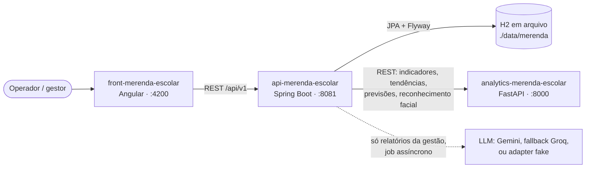

# Analytics — Controle de Merenda Escolar

Serviço analítico em Python/FastAPI do protótipo de Controle de Merenda Escolar. Ele faz duas
coisas: calcula indicadores, tendências e previsão de consumo a partir de dados já agregados pela
API Java, e faz o reconhecimento facial (DeepFace) usado no cadastro de rosto do aluno e na fila.

## Arquitetura

O protótipo é formado por três repositórios que rodam juntos:

| Repositório | Papel | Stack | Porta local |
|---|---|---|---|
| `front-merenda-escolar` | Telas: fila (QR Code e facial), cardápio, fechamento da refeição, cadastro de alunos e turmas, dashboard | Angular 20, Tailwind 4, Chart.js, html5-qrcode | 4200 |
| `api-merenda-escolar` | Regras de negócio, persistência, auditoria da fila, consolidação, jobs de relatório com LLM | Spring Boot 3.5, Java 25, Spring AI, Flyway, H2 em arquivo | 8081 |
| `analytics-merenda-escolar` | Cálculos determinísticos (indicadores, tendências, previsão) e reconhecimento facial (DeepFace) | FastAPI, Python 3.12+ | 8000 |



Princípios que orientam o código (o porquê de cada um está em `api-merenda-escolar/DECISOES-TECNICAS.md`):

- **A fila é síncrona e nunca chama o LLM.** Autoriza ou bloqueia o consumo numa transação; indisponibilidade da IA não afeta a fila.
- **A gestão é assíncrona.** O relatório com IA vira um job persistido (`relatorio_ia`); o front consulta o status.
- **Número é calculado, não gerado.** Indicadores e a conclusão numérica saem de código determinístico; o LLM só redige a partir deles e recebe apenas dados agregados.
- **O serviço Python não é dono de tabela.** Tudo o que ele precisa chega no pedido; ele não guarda foto, embedding nem dado de domínio.
- **Item é identificado por id, nunca por nome.**

Ordem para subir localmente: analytics (8000) → API (8081) → front (4200).

## Onde este serviço entra

Só a API chama este serviço. O front nunca fala com ele: a única URL base do front é
`http://localhost:8081/api/v1` (`front-merenda-escolar/src/environments/`). Do lado da API, as
chamadas ficam nos adapters de `api-merenda-escolar/src/main/java/br/com/frankcardoso/merenda/`:

| Adapter na API | Endpoint chamado | Quem usa na API |
|---|---|---|
| `analytics/infrastructure/python/PythonIndicadoresLogisticosAdapter` | `POST /api/v1/indicadores-logisticos` | `IndicadoresLogisticosService` (dashboard e relatório com IA) |
| `analytics/infrastructure/python/PythonTendenciaItemAdapter` | `POST /api/v1/tendencias-item` | `RelatorioIAWorker` |
| `analytics/infrastructure/python/PythonPrevisaoConsumoAdapter` | `POST /api/v1/previsoes-consumo` | `RelatorioIAWorker` |
| `biometria/infrastructure/python/PythonReconhecimentoFacialAdapter` | `POST /api/v1/reconhecimento-facial/embeddings` | `AlunoService` (cadastro do rosto) |
| `biometria/infrastructure/python/PythonReconhecimentoFacialAdapter` | `POST /api/v1/reconhecimento-facial/identificacoes` | `IdentificacaoFacialService` (fila em modo facial e recusa de rosto duplicado no cadastro) |

O serviço é stateless: não tem banco, o código não grava nada em disco nem lê variável de
ambiente. Tudo o que um cálculo precisa vem no corpo do pedido e a resposta sai no mesmo request.
Reiniciar não perde nada. As únicas exceções são do próprio DeepFace: o cache dos pesos do modelo
em disco e o modelo carregado em memória (ver "Reconhecimento facial").

A API encontra o serviço por `merenda.analytics.base-url` (padrão `http://localhost:8000`; em
`application.yml` vem de `MERENDA_ANALYTICS_BASE_URL`). O timeout é `merenda.analytics.timeout`
(2s) para os cálculos e `merenda.reconhecimento.timeout` (10s) para o reconhecimento facial.

Se o serviço estiver fora, a API não cai: `IndicadoresLogisticosService` devolve os indicadores
como indisponíveis, e o `RelatorioIAWorker` segue sem tendência e sem previsão. O cadastro de rosto
e a fila em modo facial dependem dele.

## Responsabilidade e limites

- Recebe somente dados agregados da API Java e devolve resultado estruturado.
- Não participa da decisão da fila, não valida consumo e não persiste nada.
- Não chama LLM. Nenhuma chamada ao Gemini ou a outro modelo de linguagem sai daqui.
- Não conhece cadastro de turma, enturmação, ingrediente nem aluno: só repassa e calcula sobre o
  que a API carimbou no pedido.
- No reconhecimento facial, recebe a foto (e, na identificação, os embeddings dos candidatos) e devolve o embedding ou a decisão. A foto
  e o embedding não ficam guardados aqui; quem guarda o embedding do aluno é a API.

## Stack

- Python 3.12+ (`requires-python = ">=3.12"` no `pyproject.toml`)
- FastAPI, Pydantic e Uvicorn
- DeepFace (reconhecimento facial)
- werkzeug (ver "Problemas comuns")
- Desenvolvimento: pytest, httpx (usado pelo `TestClient`) e ruff

Os dados chegam agregados, então esta versão usa Python padrão e Pydantic, sem Pandas apenas para
calcular razões e ordenar contagens. `pandas` e `scikit-learn` ficam como evolução planejada para
quando houver histórico suficiente (séries e composições).

## Pré-requisitos

- Python 3.12 ou superior, com o módulo `venv`.
- Acesso à internet na primeira chamada de reconhecimento facial, para baixar os pesos do modelo e
  os classificadores do detector (ver "Reconhecimento facial"). Antes de uma demonstração em outra
  máquina, rode o serviço uma vez com internet.

## Instalação

Na raiz do repositório:

**Linux/macOS:**

```bash
python3 -m venv .venv
./.venv/bin/python -m pip install -e ".[dev]"
```

**Windows (PowerShell):**

```powershell
python -m venv .venv
.\.venv\Scripts\python.exe -m pip install -e ".[dev]"
```

O extra `dev` traz pytest, httpx e ruff. Sem ele o serviço sobe, mas os testes não rodam.

## Como rodar

Na raiz do repositório (o módulo é `app.main:app`):

**Linux/macOS:**

```bash
./.venv/bin/python -m uvicorn app.main:app --reload --port 8000
```

**Windows (PowerShell):**

```powershell
.\.venv\Scripts\python.exe -m uvicorn app.main:app --reload --port 8000
```

Use a porta 8000: é a que a API espera por padrão. Suba este serviço antes da API.

## Como verificar

```bash
curl http://localhost:8000/health
```

Resposta esperada:

```json
{"status":"UP"}
```

- Swagger: `http://localhost:8000/docs`
- Contrato OpenAPI: `http://localhost:8000/openapi.json`

Os schemas completos de pedido e resposta de cada endpoint estão no Swagger e nos modelos
Pydantic de `app/domain/`.

## Estrutura de pastas

```text
analytics-merenda-escolar/
├── app/
│   ├── main.py                     # cria o FastAPI, registra os routers e expõe /health
│   ├── api/                        # camada HTTP: um APIRouter por recurso, prefixo /api/v1
│   │   ├── indicadores_controller.py
│   │   ├── previsoes_controller.py
│   │   ├── reconhecimento_facial_controller.py   # traduz erro de detecção em HTTP 422
│   │   └── tendencias_controller.py
│   └── domain/                     # contratos Pydantic e cálculo, sem dependência de FastAPI
│       ├── indicadores_logisticos.py
│       ├── previsao_consumo.py
│       ├── reconhecimento_facial.py
│       └── tendencia_item.py
├── scripts/
│   └── gerar_rostos_demo.py        # semente de rostos de demonstração (LFW)
├── tests/
│   ├── api/                        # endpoints via TestClient
│   └── domain/                     # regras de cálculo, sem HTTP
└── pyproject.toml                  # dependências, configuração do pytest e do ruff
```

Para um cálculo novo, o padrão do repositório é: modelos de pedido e resposta mais a função de
cálculo em `app/domain/`, um router em `app/api/`, o `include_router` em `app/main.py` e testes
nas duas pastas de `tests/`.

O JSON trafega em camelCase (aliases do Pydantic) e o código Python usa snake_case.

## Endpoints

| Método | Caminho | O que faz |
|---|---|---|
| `GET` | `/health` | Verificação de vida; devolve `{"status":"UP"}`. |
| `POST` | `/api/v1/indicadores-logisticos` | Indicadores do dia/refeição e das janelas de 7 e 30 dias: execução do planejamento, atendimentos, ranking de itens, aceitação, desperdício, ingredientes e turmas. |
| `POST` | `/api/v1/tendencias-item` | Classifica a série de taxas de execução de cada item em `QUEDA`, `ESTAVEL` ou `ALTA`. |
| `POST` | `/api/v1/previsoes-consumo` | Estima a demanda da refeição a partir do realizado do dia e do histórico. |
| `POST` | `/api/v1/reconhecimento-facial/embeddings` | Gera o embedding da foto de referência do aluno (cadastro do rosto). |
| `POST` | `/api/v1/reconhecimento-facial/identificacoes` | Identifica quem é a pessoa da foto entre os candidatos recebidos (1:N). |

### Indicadores logísticos

`POST /api/v1/indicadores-logisticos` recebe dados já agregados pela API. O contrato rejeita campos
desconhecidos (`extra="forbid"`): campo a mais ou a menos do lado Java vira HTTP 422.

Entrada: `dataReferencia`, `inicioHistorico`, `refeicao` (`{"id", "nome"}`, a refeição da grade da API:
Café da manhã, Lanche da manhã, Almoço, Lanche da tarde ou Lanche da noite), `historicoSemRefeicao`
(opcional, padrão 0: quantos registros do histórico do legado a API não conseguiu ligar a uma refeição),
`quantidadePlanejada`, `consumosRegistrados`, `alunosUnicos`, `metaPercentual` (padrão 80),
`turmas`, `itens`, `medicaoDoDia`, `receitasMedidas`, `fechamentosDoMes`, `fechamentosDaSemana`,
`quantidadeFechamentosDoMes`, `quantidadeFechamentosDaSemana`, `datasFechamentosDoMes`,
`receitasSelecionadas`, `datasSelecionadas`, `coberturaFechamentosCompleta` e `atendimentoDiario`
(opcional: `[{data, planejadas, atendidos}]` dos dias da janela; dia com `planejadas` 0 é tratado como dia sem
cardápio e fica fora das médias).

Saída versionada (`schemaVersion="6"`, `calculoVersao="indicadores-v1"`): `refeicao` (devolvida como veio),
`execucaoPlanejamento`,
`atendimentos`, `topComidas`, `aceitacaoItens`, `aceitacaoItensSemana`,
`quantidadeFechamentosDoMes`, `quantidadeFechamentosDaSemana`, `datasFechamentosDoMes`, `porTurma`,
`aceitacao`, `desperdicio`, `ingredientes`, `rotacaoCardapio`, `planoDeAcao` e `avisos`.

A versão 6 acrescenta: `sobraPercentual` em cada item de `aceitacaoItens` e `aceitacaoItensSemana`
((preparado - servido) / preparado, 1 casa; nulo sem preparado); `mediaAtendidosDia` e `mediaPlanejadaDia` em
`execucaoPlanejamento` (nulos sem `atendimentoDiario`); e `planoDeAcao`, lista determinística de
`{tipo, receitaId, item, texto, valor, referencia}` com os tipos `REVER_PLANEJAMENTO` (atendimento médio abaixo de
80% do planejado, sempre primeiro), `REVISAR_PREPARACAO` (aceitação do item abaixo de 90%) e `REDUZIR_PREPARO`
(sobra na panela a partir de 10%). Itens com menos de 3 fechamentos ficam fora do plano. Sem escopo de cardápio
(`datasSelecionadas` e `receitasSelecionadas` vazios) os fechamentos da janela são a cobertura: aceitação e
desperdício deixam de ser "não avaliáveis" por causa de `coberturaFechamentosCompleta`.

A versão 5 troca `turno` por `refeicao` no pedido e na resposta. A API só aceita resposta nova com
`schemaVersion="6"` (`PythonIndicadoresLogisticosAdapter`) e também confere que o `refeicao.id` devolvido
é o que enviou. Relatórios já persistidos com `"2"`, `"3"` ou `"4"` continuam legíveis: a API devolve a fotografia gravada
e o front trata a ausência de `turmaId` nessas versões. Mudou o contrato de saída, suba a versão
aqui e no adapter Java juntos.

Regras de cálculo:

- **Meta:** a comparação é feita antes do arredondamento (79,999% não atinge 80%). Sem refeições
  planejadas, o percentual é nulo e o status é `NAO_AVALIAVEL`.
- **Repetições:** consumos registrados menos alunos únicos do mesmo dia e refeição.
- **Ranking (`topComidas`):** execuções registradas / planejamentos, mínimo de 5 planejamentos por
  item, top 10, desempate pelo tamanho da amostra e depois pelo nome. Não é ranking de aceitação
  nem de refeições completas.
- Quantidade servida zero conta como registro; ausência de registro não comprova rejeição.
- **Histórico sem refeição:** com `historicoSemRefeicao` maior que zero, `avisos` ganha a quantidade de
  registros do legado (lanches mistos, turno estendido) que ficaram fora da análise por refeição.
- **Turmas:** os indicadores por turma continuam, agora dentro de uma refeição. `turmas` recebe `turmaId` (nulo no balde "Sem turma") e `turma` (texto obrigatório);
  a resposta repete `turmaId` em cada item de `porTurma`. `turma` nula é rejeitada com HTTP 422.
- Sem presença elegível, a adesão por turma não é calculada: cada turma segue `NAO_AVALIAVEL`,
  mesmo com a turma modelada na API.
- **Aceitação por item:** `aceitacaoItens` exige ao menos 3 fechamentos do item na janela do mês;
  `aceitacaoItensSemana` exige 1.
- **Aceitação e desperdício do período:** com fechamentos na janela, usam a soma dos fechamentos do
  mês e só são classificados quando `coberturaFechamentosCompleta` vem `true`; sem fechamentos,
  usam `medicaoDoDia`, que precisa cobrir todas as receitas do cardápio. Abaixo de 30 porções registradas, o resultado é `DADOS_INSUFICIENTES`.
- **Faixas (convenção do protótipo, não medidas em produção):** aceitação `ALTA` a partir de 90% e
  `MEDIA` a partir de 75%; desperdício `BAIXO` até 10% e `MEDIO` até 20%. As constantes ficam no
  topo de `app/domain/indicadores_logisticos.py`.
- **Ingredientes:** compara o resto dos pratos que levam o ingrediente contra os pratos sem ele,
  exige 30 medições de amostra e devolve no máximo 3. É associação observada, não causa: o resto é
  medido por prato inteiro.
- **Rotação de cardápio:** hoje `rotacaoCardapio` sai sempre `DADOS_INSUFICIENTES`, porque faltam
  séries de oferta e adesão comparáveis para recomendar um ciclo.

### Escopos dos indicadores

O dia e a refeição de referência representam a fotografia operacional: planejamento, autorizações,
bloqueios e registros por turma. A aceitação e o desperdício são calculados a partir dos
fechamentos da merendeira dos últimos 7 ou 30 dias até a data de referência (a janela é montada
pela API, em `IndicadoresDadosService`).

Quando o gestor seleciona um cardápio, a API já envia os fechamentos restritos às datas completas
desse cardápio, e o Python filtra `fechamentosDoMes`, `fechamentosDaSemana` e `receitasMedidas`
pelos ids de `receitasSelecionadas`. Registros da fila não são tratados como prova de ingestão.

### Previsão de consumo

`POST /api/v1/previsoes-consumo`. Recebe `refeicao` (o nome da refeição, texto) no lugar do antigo
`turno`. A demanda estimada é a média do `historico` enviado, com o
realizado do dia como piso (prever abaixo do que já aconteceu é impossível). A confiança depende do
tamanho do histórico: 7 ou mais registros `ALTA`, de 3 a 6 `MEDIA`, menos que isso `BAIXA`. O
`riscoDesperdicio` é sempre `NAO_AVALIAVEL`: a diferença entre planejamento e autorizações é sobra
de planejamento, não desperdício medido.

Request:

```json
{
  "dataReferencia": "2026-08-26",
  "refeicao": "Lanche da noite",
  "cardapio": "Arroz, feijao, frango e salada",
  "quantidadePlanejada": 300,
  "consumosAutorizados": 120,
  "tentativasBloqueadas": 3,
  "taxaConsumoPlanejado": 0.4,
  "sobraDePlanejamento": 180,
  "historico": [
    {"dataReferencia": "2026-08-25", "consumosAutorizados": 250},
    {"dataReferencia": "2026-08-24", "consumosAutorizados": 262},
    {"dataReferencia": "2026-08-21", "consumosAutorizados": 241}
  ]
}
```

Response:

```json
{
  "demandaEstimada": 251,
  "mediaHistorica": 251,
  "pisoRealizado": 120,
  "origemEstimativa": "MEDIA_HISTORICA",
  "diferencaPrevisaoPlanejamento": -49,
  "riscoDesperdicio": "NAO_AVALIAVEL",
  "desperdicioMotivo": "Nao ha medicao de sobra nao distribuida nem de resto no prato. A diferenca entre planejamento e autorizacoes e sobra de planejamento, nao desperdicio de alimento.",
  "confianca": "MEDIA",
  "metodo": "baseline-estatistico-v2",
  "evidencias": [
    "Foram autorizados 120 consumos de 300 refeicoes planejadas.",
    "A sobra de planejamento informada pela API Java foi de 180 refeicoes; e diferenca de planejamento, nao desperdicio medido.",
    "A media de 3 registros historicos foi 251 consumos.",
    "Houve 3 tentativas bloqueadas no periodo."
  ]
}
```

`origemEstimativa` vale `MEDIA_HISTORICA`, `PISO_REALIZADO` (a média ficou abaixo do realizado do
dia) ou `REALIZADO_SEM_HISTORICO` (sem histórico, a estimativa é o próprio realizado).

### Tendência por item

`POST /api/v1/tendencias-item` recebe `itens`, cada um com `item` e `taxasExecucao`. Compara a
média da segunda metade da série com a da primeira: queda de 5 pontos percentuais ou mais é
`QUEDA`, alta de 5 ou mais é `ALTA`, o resto é `ESTAVEL`. Série com menos de dois pontos é
`ESTAVEL`. A API envia o id da receita em `item`, e o serviço devolve a mesma chave que recebeu.

```json
{"itens": [{"item": "<id da receita>", "taxasExecucao": [80, 82, 70, 68]}]}
```

```json
{"tendencias": [{"item": "<id da receita>", "tendencia": "QUEDA"}]}
```

### Reconhecimento facial

Implementado em `app/domain/reconhecimento_facial.py` com DeepFace, modelo `Facenet` (padrão e o
que a API envia; o contrato também aceita `Facenet512`, `SFace` e `ArcFace`) e detector `opencv`,
com detecção obrigatória (`enforce_detection=True`).

- **`POST /api/v1/reconhecimento-facial/embeddings`**: recebe `fotoBase64` (e `modelo`, opcional) e
  devolve `embedding` e `modelo`. A foto precisa ter exatamente um rosto. A API guarda o embedding
  no cadastro do aluno.
- **`POST /api/v1/reconhecimento-facial/identificacoes`**: recebe `fotoBase64`, `candidatos` (lista
  de `{id, embedding}`, ao menos um) e `modelo` (opcional). Devolve `decisao` (`RECONHECIDO`,
  `NAO_RECONHECIDO` ou `AMBIGUO`), `melhorCandidatoId`, `distancia` e `distanciaSegundo` (4 casas),
  `limiar`, `margemMinima`, `candidatosIgnorados` e `modelo`.

`fotoBase64` é a imagem em base64; o front manda o data URL do canvas
(`data:image/jpeg;base64,...`) e a API repassa sem alterar.

Pontos que importam:

- **A identificação é 1:N.** A API manda os embeddings de todos os alunos ativos com rosto
  cadastrado e o serviço compara a foto com cada um, com distância cosseno.
- **Decisão.** `RECONHECIDO` só quando a menor distância fica abaixo do limiar do modelo
  (`find_threshold("Facenet", "cosine")` = 0.4) **e** o segundo colocado está pelo menos
  `MARGEM_MINIMA = 0.08` mais longe. Perto demais: `AMBIGUO`. Acima do limiar: `NAO_RECONHECIDO`,
  também quando não sobra candidato comparável.
- **Maior rosto.** Se a foto tem mais de um rosto, vale o de maior área (quem está na frente da
  câmera). O cadastro (`/embeddings`) continua exigindo exatamente um.
- **Dimensão diferente.** Candidato cujo embedding tem outra dimensão que o da foto (cadastrado com
  outro modelo) não é comparável: é ignorado e contado em `candidatosIgnorados`.
- **Calibração.** Com cinco adultos do LFW cadastrados e uma imagem de teste diferente para cada
  um: distância própria de 0.23 a 0.30, menor margem para o impostor mais próximo 0.4186 e rosto
  desconhecido a 0.6050 do mais próximo. A margem de 0.08 ficou como está. Tabela e ressalvas em
  `DECISOES-TECNICAS.md` da API, seção 8. Não vale para crianças.
- **Nada é guardado.** O serviço nunca grava foto nem embedding, nem em disco nem em memória depois
  do request.
- **Erros de detecção viram HTTP 422.** Sem rosto detectável, nos dois endpoints (na identificação, só a foto; candidatos sem `id` ou sem embedding são erro de contrato, também 422); mais de um rosto,
  só no cadastro (mensagem "N rostos detectados na foto; cadastro exige exatamente um."). A API
  distingue os dois casos pelo texto: se a mensagem não contém "rostos detectados", ela trata como
  rosto não detectado. Não mude esse texto sem mudar `PythonReconhecimentoFacialAdapter`.
- **Primeira chamada é lenta.** A primeira chamada facial da máquina baixa os pesos do Facenet
  (cerca de 90 MB, `facenet_weights.onnx`) para `~/.deepface/weights` (o DeepFace usa
  `DEEPFACE_HOME` no lugar de `~` quando definido). Em toda subida do processo, a primeira chamada
  ainda carrega o modelo na memória; com `--reload`, cada recarga reinicia o processo.
- **O detector também baixa arquivos.** No primeiro uso o `opencv` baixa
  `haarcascade_frontalface_default.xml` e `haarcascade_eye.xml` de github.com para
  `~/.deepface/weights/`. Sem rede nessa primeira vez, a chamada falha.

#### Semente de rostos de demonstração

`scripts/gerar_rostos_demo.py --lfw-dir <pasta do LFW>` gera, a partir de adultos do dataset público
LFW (baixado de https://ndownloader.figshare.com/files/5976018), o `rostos-demo.json` da API
(`ALU-9001` a `ALU-9005`, só com embeddings) e as imagens de teste em
`api-merenda-escolar/demo/rostos-teste/`. Só entram identidades cuja imagem de teste, diferente da
de cadastro, é reconhecida com distância própria até 0.30; a semente do sorteio é 2026. Os nomes
dos alunos são fictícios. O script usa as mesmas funções do serviço, então os números saem do
mesmo modelo e do mesmo detector. Os testes automatizados nunca usam essas imagens.

## Testes e lint

O pytest está configurado no `pyproject.toml` (`testpaths = ["tests"]` e `pythonpath = ["."]`),
então rode da raiz do repositório:

**Linux/macOS:**

```bash
./.venv/bin/python -m pytest -q
./.venv/bin/python -m ruff check .
```

**Windows (PowerShell):**

```powershell
.\.venv\Scripts\python.exe -m pytest -q
.\.venv\Scripts\python.exe -m ruff check .
```

Para um arquivo só: `./.venv/bin/python -m pytest tests/domain/test_reconhecimento_facial.py -q`.

Os testes de reconhecimento facial substituem `DeepFace.represent` por mock e usam vetores inventados, sem imagem nem embedding de pessoa real:
não precisam de câmera, de foto real nem dos pesos do modelo, e não acessam a rede. A suíte inteira
roda em cerca de um segundo.

## Problemas comuns

- **Erro de import do `werkzeug` ao subir ou testar.** O DeepFace importa o werkzeug mesmo fora do
  extra "api", por isso ele está declarado nas dependências do `pyproject.toml`. Se aparecer, o
  ambiente está sem as dependências declaradas no projeto: rode de novo
  `./.venv/bin/python -m pip install -e ".[dev]"`.
- **`ModuleNotFoundError: app` ou nenhum teste encontrado.** Os comandos precisam rodar na raiz do
  repositório, onde estão `app/` e o `pyproject.toml`.
- **Cadastro de rosto ou fila facial falhando por timeout logo depois de subir.** A API espera no
  máximo 10s (`merenda.reconhecimento.timeout`), e a primeira chamada da máquina baixa cerca de
  90 MB de pesos. Depois que `~/.deepface/weights/facenet_weights.onnx` existe, não há novo
  download.
- **HTTP 422 no reconhecimento facial.** É falta de dado, não "não reconhecido": a foto não tem
  rosto detectável pelo `opencv` ou, no cadastro, tem mais de um rosto. "Não reconhecido" e
  "ambíguo" são HTTP 200, na `decisao`.
- **Dashboard com indicadores indisponíveis.** A API registra no log
  `Indicadores indisponíveis para <data> / <refeição>: <exceção>` e devolve os indicadores com
  `status="INDISPONIVEL"`. Causas
  vistas no código: este serviço fora do ar, HTTP 422 por contrato divergente (o pedido aceita só
  os campos conhecidos) ou resposta com `schemaVersion` diferente de `"6"`.
- **Avisos de depreciação no pytest.** Os dois avisos do starlette/httpx sobre o `TestClient` não
  indicam falha.
- **`ruff check .` não sai limpo.** Hoje ele aponta 5 problemas em
  `app/domain/indicadores_logisticos.py` (ordem dos imports e linhas acima de 100 colunas). Não é
  causado por mudança sua.

## Pendências e próximos passos

- Incorporar presença elegível aos cálculos de adesão por turma quando a API disponibilizar essa base.
- Avaliar métricas históricas de tendência e comparação entre cardápios com dados reais suficientes.
- Revisar a análise de ingredientes para reduzir ambiguidades quando vários ingredientes aparecem no mesmo prato.
- Manter a distinção entre dados sintéticos, registros da fila e medições de sobra nos avisos da resposta.
- Reconhecimento facial para produção: prova de vida, recadastro periódico, piloto com crianças para calibrar limiar e margem, busca restrita à escola e LGPD (ver `DECISOES-TECNICAS.md` da API, seção 8).
